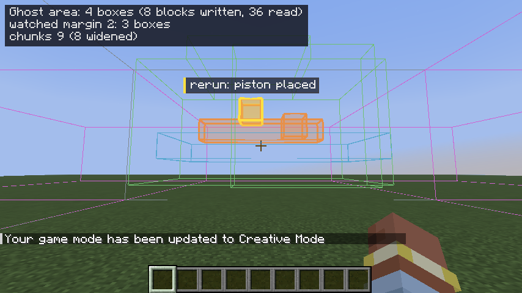

# Ghost Path

Ghost Path shows where TNT and projectiles will go before you pull the lever. It runs your machine once in a hidden copy of the world, then draws every TNT, arrow, pearl, item and falling block as a line in the world, with the reason each one ends (`exploded`, `hit block`, ...). When you change the machine, the lines update by themselves. Your real world is not changed.

## What you need

- Minecraft Java **26.2**, Fabric Loader **0.20.1** or newer, Java 25.
- **Fabric API 0.161.0+26.2** (or a newer 26.2 build).
- **Singleplayer** (and a LAN world you host). It is not meant for servers or multiplayer.

Put `ghostpath-0.1.0.jar` and the Fabric API jar in your `mods` folder. Cheats must be on in the world (the commands need operator rights; the owner of a singleplayer world always has them).

## How to use it

1. Build your machine. Stand where you can see it.
2. Look at the block that starts it, and run `/path machine <x> <y> <z>` with that block's position. Supported triggers: **lever, button, note block** (a right click tunes it one note up), **trapdoor, door and fence gate** (not iron: they open by hand), **repeater** (delay +1) and **comparator** (switches mode). Each is pressed the way a right click does it, without a player (a fence gate does not turn to face you and makes no sound). Anything else: the chat lists the supported blocks. A rerun first puts the trigger back to the state you recorded (for a note block: the recorded note) and presses it again.
3. The mod presses the trigger, follows everything the machine sets in motion until it is quiet, and puts the world back as it was. The chat shows a summary. Lines and dots now hang in the world.

What the summary means:

- **Recorded ... N ticks**: how long the machine ran. `STOPPED AT THE TICK LIMIT` means it was still busy (see `/path limit`).
- **Footprint**: how many blocks the machine wrote and read. A change in any of them reruns the preview.
- **TNT spawned**: how many TNT the machine lit.
- **Unseeded draws**: places where the game uses chance that the mod could not fix. Warnings here mean the result may not repeat exactly.
- **Restore**: what was put back. Things that other parts of the world changed meanwhile are left alone and counted.
- **Ghost check: exact** means a second run in the hidden copy gave exactly the same result as the real run. If it says something else, the first difference is named (tick, what, both values).

### Live updates

After `/path machine` the machine is watched. When you place or break a block that the machine reads or writes, **or one next to a block the machine changed, or within 2 blocks of one** (`/path watch margin <n>`, 0 to 8; measured from the machine's own blocks, so a long thin machine watches a thin tube), wait about half a second (10 quiet ticks) and the mod reruns it in a fresh copy. The chat says `rerun: N ticks, K TNT spawned, ...` and what changed since last time, and the lines move to the new prediction. If the real lever is already on, the chat says so; the prediction is still for the press from off to on.

- `/path watch list` shows what is watched. `/path watch stop` (or `stop <x y z>`) stops it.
- `/path rerun` (or `/path rerun <x y z>`) reruns the watched machine(s) now, without waiting for a change (it still waits until the real machine is idle). Several watched machines, even in one chunk, rerun one after the other.
- The chat line also says how long the copy took: `copied in 40 ms over 12 ticks`. A long machine's copy is spread over server ticks with the same time budget as the run, so the game does not stall.
- A change of air to air, or in a chunk that is not loaded, does not count.
- If the chunks around the machine are loaded differently than when you recorded it (you walked away or closer, or changed the simulation distance), the chat line says `chunk loading changed since recording: chunk X Z: block ticking -> entity ticking; ...`. The rerun uses the loading as it is now.

### Frozen entities (lazy chunks)

A chunk next to the loaded area can be loaded without ticking entities (a "lazy" chunk). Things in it **freeze**: they do not move and a TNT fuse does not count down. But explosions still change a frozen entity's velocity (lazy acceleration), and pistons in such a chunk can still push it. The mod records this as it happens:
- A frozen entity never keeps a recording or a rerun going. The run ends when the rest of the machine is done, and the path ends with `frozen: lazy chunk` (or `frozen: unloaded`).
- No line is drawn while it is frozen. A light-blue dot marks where it froze, with `frozen N ticks` under it. If it ticks again, the line goes on from where it is then. If a piston moved it while it was frozen, a dashed light-blue line connects the two places.
- Point at the light-blue dot: the panel lists its velocity at the end of every frozen tick, and which explosions (number and tick) pushed it. That is how you can see velocity building up.

### Ghost area

`/path area on` shows what the machine touched, as boxes: **orange** (strong, filled) for blocks the machine **wrote**, **thin blue** for blocks it only **read**. The block change that started the last rerun is highlighted yellow for a few seconds with a label like `rerun: piston placed`. At most 2000 boxes are drawn; the top left says so when there were more. Two optional layers: `/path area watched on` (green: the margin around the machine's blocks, the area whose changes rerun it) and `/path area chunks on` (the chunks the last run copied; chunks a widened run added are magenta). `/path area off` hides it. The overlay is updated with the lines after every recording and rerun. A key is available in the controls ("Show or hide the ghost area") but **unbound** by default.

### Looking at a path

- Point at a dot: its exact bounding box and a panel appear (position, velocity, fuse, tick, how it ends). Positions are written so that nothing is rounded.
- Paths behind blocks are hidden. Hold the **inspect key (V)** to point through blocks.
- **Pin**: hold V and left click a dot. A pin sticks to its tick number across reruns. Click it again to unpin. `/path pins clear` removes all pins.
- Many identical TNT show as one line with `×N`. Hold V and scroll to step through them.
- Point at a real TNT or arrow and you see the server's exact values; stacks show a count.
- `/path inspect hold` (default) or `/path inspect toggle` chooses whether V works while held or switches on and off each press.
- Arrows that were still flying when the recording stopped are continued on your computer and drawn lighter, labelled `continued`. You can point at those too. They are an estimate made by your client, not the server's run.

### Saved paths

`/path save <name>` keeps the current prediction (every path per tick as exact doubles, ×N counts, end reasons, freeze and frozen marks, the client's continuation points, plus the machine's trigger, dimension, tick count, game time and date). Names are `a-z 0-9 _ -`, 1 to 32 characters; `/path save <name> replace` overwrites. A saved path is a **snapshot: it never reruns**; it is drawn lighter than the live prediction with `[name]` on its labels, only in its own dimension, and can be hovered (box and panel with a `saved: <name>, <date>` line; saved points cannot be pinned). Key G and `/path show off` hide saved paths too. A new save is shown.

- `/path saved list [archived]`, `/path saved show <name>`, `/path saved hide <name|all>` (shown or hidden is saved too)
- `/path saved archive <name>`, `/path saved unarchive <name>` (comes back hidden), `/path saved delete <name>` then `/path saved delete <name> confirm` within 30 seconds
- Files: `<world>/ghostpath/saved/<name>.nbt` and `.../saved/archive/<name>.nbt` (compressed NBT with a format version, written through a temp file and renamed). A file that cannot be read (unknown version, broken) is skipped with a chat warning (on joining the world and in `list`) and never deleted.
- No import or export between worlds. Live paths and saved paths share the 30000 segment cap; saved ones are cut first and the HUD says so.

### Animation

When a rerun changes the prediction the lines morph from the old to the new in about 0.4 s (ease in and out, real time, so it plays while the game is paused). Paths are matched by type and chain entity index; longer paths draw on, shorter ones retract, unmatched old ones fade out, new ones fade in. A second rerun during a morph starts from what is drawn. It is only a view: hover, pins and the inspector use the final data. Skipped above 500 paths, when the segment cap would be hit, and for recordings or other machines. `/path animation on|off|fast` (fast = 0.15 s), saved in `config/ghostpath.json` (`animation`).

### Look

`/path style default|soft|contrast` (saved in the config as `style`). Every colour, width, size, alpha and timing is in the `Style` class (three presets); change a number there to change the look. Labels are drawn in the HUD as dark pills with a marker for the end reason; overlapping labels show the nearest and fade the others, far ones fade out. Panels have sections (entity, position, velocity, state, chunk) with aligned decimal points and stay on screen. Messages above the hotbar fade in and out. Chat lines start with `Ghost Path » ` (info, success, warning, error colours, numbers highlighted).

### Commands

| Command | What it does |
|---|---|
| `/path machine <x y z>` | Record, check and start watching a machine. |
| `/path show on\|off` | Show or hide the lines. Key **G** does the same. |
| `/path beyond-loaded on\|off` | On (default): a rerun that reaches past the loaded area takes the missing chunks from your save (see below). Off: loaded chunks only. |
| `/path interval <ticks> [offset <n>]` | A dot every N ticks (default 5). The first and last dot are always there. |
| `/path kick on\|off` | The small random push TNT gets when lit. Off: drawn without the sideways part, so the path does not wobble. |
| `/path limit <ticks>` | The longest a recording may run (default 2000). |
| `/path watch list\|stop` | See or stop watched machines. |
| `/path watch margin <n>` | Blocks around the machine's own blocks whose change reruns it (default 2; the six neighbours always count). |
| `/path rerun [x y z]` | Rerun the watched machine(s) now. |
| `/path area on\|off` | The machine's footprint as boxes (see "Ghost area"). |
| `/path area watched\|chunks on\|off` | The watched margin; the copied chunks. |
| `/path inspect hold\|toggle` | How the inspect key works. |
| `/path pins clear` | Remove all pins. |

Keys (Options, Controls, "Ghost Path"): **G** show/hide, **V** inspect, and one for the ghost area (unbound).

## End reasons

| Reason | Meaning |
|---|---|
| `exploded` | TNT went off. |
| `hit block` / `hit entity` | A projectile hit something. |
| `stuck` | An arrow stayed in a block for 8 ticks. |
| `landed` | A falling block became a block again. |
| `settled` | An item or vehicle stopped moving for 8 ticks. |
| `limit` | Still going when the recording stopped. |
| `left dimension` | It went through a portal-like transfer into another dimension. |
| `portal` | It reached a portal. Portals are not simulated. |
| `unloaded` | It was removed with its chunk. |
| `frozen: lazy chunk` / `frozen: unloaded` | It was still frozen (its chunk does not tick entities) when the run ended. |
| `removed` | It was removed for another reason. |
| `out of world`, `failed` | Only for the continued arrows: fell out of the world, or the estimate could not be made. |

## Known gaps

- **Portals** are not simulated; a path that reaches one ends there. Entities that change dimension are not followed.
- **Players** are not in the hidden copy: a player standing in the machine's way, riding something, or pushed by TNT is not predicted. **Player-owned ender pearls** keep chunks loaded around them in the real game; the copy cannot do that, and the summary says `player-owned pearl: chunk loading not simulated`. (A machine's own pearls, from a dispenser, load nothing in the real game either.)
- **Mobs**: a machine that depends on mobs (their AI, sheep shearing, villagers, bees) cannot be predicted exactly. The summary says `inexact`.
- **Sculk sensors and other listeners** far from the machine, and anything the machine only reaches through vibrations to mobs, are not followed. Points of interest (villager jobs, bees, lightning rods) are not copied.
- **Loot** (a block's drops, such as flint from gravel) is rolled from the same numbers in the real run and the copy, and your world's own loot sequences are not used up by a recording.
- **Chance outside the machine**: random block ticks (crops, fire, ice), weather changes, and mob spawning do not run in the hidden copy.
- **Light** and things like redstone torch burn-out history, trial spawners, vaults and bells (which keep absolute times) are not carried over exactly.
- **The world border** is not copied.
- **Long runs**: a machine that does not go quiet (a clock) runs until the tick limit and is not watched. Raise or lower `/path limit`.
- While a recording or a rerun is working, the world's autosave waits.
- Only the last finished run is drawn when several machines are watched.
- **Far shots**: the machine's own chunks must be loaded. If a rerun finds that TNT or a projectile flies beyond the copied area, the mod widens the area (up to 4 times, 3 chunks each) and takes chunks that are not loaded from your **save** (without loading them in the world; `/path beyond-loaded off` turns this off). Chunks that are loaded but do not tick entities in the real world (the two rings around loaded chunks) are treated like them. In the ghost all of those tick, so the line keeps going, but **from the first point in a chunk where the real world would freeze the thing, the line is dashed and faded**, an amber dot and the label `real: freezes here (unloaded)` or `(lazy)` mark that point, and the end label gives both: `real: frozen at t+36; ghost: hit block at t+52`. The chat line lists them too. The save gives blocks, block entities (chests...), scheduled ticks (a repeater's pending tick keeps its remaining delay) and entities (TNT, items, mobs in that chunk as last saved; they get new entity ids and fresh random numbers, so behaviour that depends on those may differ: that part of a path is labeled as beyond loaded anyway). A chunk that is half-unloaded (the server still holds it with unsaved changes) is taken from memory, newer than the save. Not from the save: block events, POI, nothing newer than the last write.

If something looks wrong, check `logs/latest.log` and tell us which machine and which command.
